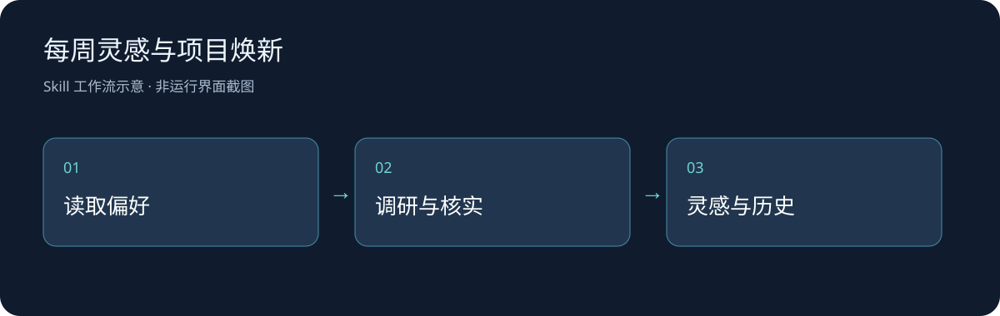

# 每周灵感与项目焕新

将可访问项目与有出处的新能力连接起来，生成可追溯灵感并维护本地推荐历史；由用户手动发起。

## 安装与使用

这是提供给支持 `SKILL.md` 的AI Agent宿主的技能包。宿主负责模型、文件权限和可用工具；仓库本身不是独立网页或已部署服务。

1. 下载源码，将整个目录放入宿主的用户技能目录，并以 `weekly-inspiration` 命名。例如Codex的用户技能目录为当前用户下的 `.codex/skills/`。
2. 保持 `SKILL.md` 与其子目录的相对位置，重新加载宿主技能清单。
3. 在对话中使用 `$weekly-inspiration` 并给出任务材料。宿主是否自动匹配、显示方式与工具名称取决于实际版本。

## 文件与运行条件

`SKILL.md` 为入口，`references/`（如有）为按需资料，`agents/`（如有）为展示元信息，`scripts/`（如有）为辅助脚本。真实资料、认证、个人状态、依赖和生成缓存不在源码范围内。

## 示例与验证

> 用 $weekly-inspiration 只读复查我指定的项目目录，列出有证据的改进机会。此次状态写入我指定的独立绝对路径，不改项目。

完整周调研需要宿主具备联网检索及获准的项目读取能力；没有连接的来源须列出覆盖缺口。个人状态保存在独立本地目录，不能加入公开仓库。不会自动设定提醒、后台服务或实施推荐。此次只检查文件完整性、引用和静态隐私；未在新的宿主会话执行完整周调研。

## 状态与后续

已有可用工作流；本轮是公开归档与可移植说明整理。后续可根据新的宿主会话和实际案例补充验证记录，不把文档存在等同于自动化效果已验证。

自有内容采用 [MIT](LICENSE)，第三方内容与依赖保留原归属。
